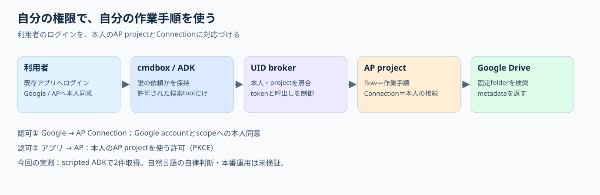

# cmdbox-activepieces-lab

## 読む順序

1. [アイデアと二段の認可](docs/CONCEPTS.md)：非エンジニア向け説明とSVG図。
2. [三者の役割](docs/RESPONSIBILITIES.md)：顧客管理者、実ユーザー、提供側。
3. [実測／見込み／未検証](docs/GOOGLE-DRIVE-E2E.md)：scripted ADKの限定成功と終了状態。
4. [実装エージェント向け入口](docs/IMPLEMENTATION-GUIDE.md)：source・契約・offline checks・制約。




2026-10-12、既存UIDからnative cmdbox Web→Redis→worker→実Google ADK→AP CE標準Drive flowを通じ、テスト用A.txt/B.txtの2件を取得しました。AP標準OAuth中継の成功経路では顧客/実ユーザーの独自GCP client登録は不要でした。modelはscriptedで、自然言語の自律判断・本番運用は未検証です。[今日の結果・障害経過・終了](docs/GOOGLE-DRIVE-E2E.md)、[顧客管理者・利用者・提供側の作業](docs/RESPONSIBILITIES.md)。

通常runtimeはlab_drive_search一つ。管理MCP42toolsは独立開発接続で確認し、元flowだけ読取/有効化。元の同じ検索台帳で初回失敗＋最後の成功の2/2を消費し、AP grant失効/local token除去/app停止/元通信・cache復旧を確認。Google ConnectionはACTIVEで残りGoogle grant失効は未確認。公開範囲はsanitized文書/sourceで、Space整理は別担当です。

先行する[local/mock](docs/CONTINUATION.md)と[A/B合成flow](docs/PHASE2-VALIDATION.md)は別の履歴。custom pieceは未適用で、汎用MCP proxy、Slack実接続、実LLM、本番vault/TLS/多利用者展開は未完了です。

公開cmdbox、Activepieces Community Edition、Google ADKを使い、ログインUIDごとのMCP実行を検討するWindows向け検証プロジェクトです。非公開業務アプリのコードやGoogle/Slackの実credentialは含みません。

独立した合成試験として、UID adapterの35件と、実Webログイン→Redis→native cmdbox worker→実ADK→ダミーツールの11シナリオが通過しています。過去の実AP/MCP/ADK試験とは別の結果です。[検証レポート](docs/VALIDATION.md)、[設計](docs/ARCHITECTURE.md)、[残る課題](docs/NEXT-STEPS.md)、[管理者・利用者・提供者の作業](docs/RESPONSIBILITIES.md)を参照してください。

## LOCAL MOCKの再現

まず[offline checks](docs/IMPLEMENTATION-GUIDE.md)を実行します。[最終検証結果](docs/public-reference-checks-summary.json)はdummy98件＋実ADK scripted7件です。GitHub CIもoffline checksのみで、アプリやAP/Redisを起動しません。

追加のnative Web/worker合成試験にはPowerShell 7、Git、正常稼働するDocker Desktop/Composeが必要です。初回setupは固定された公式public source/wheel/tokenizer assetを取得します。system Python、Docker Desktop全体の保存先、他projectを変更しません。CPython3.12.10の専用runtimeを再構築する方式で、既存venvをコピーしません。

```powershell
.\Setup-ADK.ps1
.\app-lab\Setup-AppLab.ps1
.\tools\Fetch-PublicSources.ps1
.\runtimes\python312\python.exe -X utf8 tools\prepare_cmdbox_copy.py

# 実AP・Redisを使わない選択したstock経路のdummy-only回帰 + 実ADK dummy7シナリオ
.\runtimes\python312\python.exe -X utf8 poc\run_mock_tests.py

# 専用Redis/固定TCPプロキシだけを起動
docker compose -f app-lab/compose.yml -p cmdbox-ap-lab-mock up -d
.\runtimes\python312\python.exe -X utf8 app-lab\test_app_path.py
docker compose -f app-lab/compose.yml -p cmdbox-ap-lab-mock stop
```

Webは127.0.0.1:18090、Redisプロキシは127.0.0.1:18091です。既存listenerを勝手に停止しません。11件のtest harnessが所有Web processを起動・再起動・停止します。手動起動は`python app-lab/server.py`、停止は同じterminalへ`STOP`を入力、またはCtrl+C。最小native routeのみを使い、標準管理UI全体を検証したものではありません。

合成password、cookie ID、署名鍵は公開literalです。本番配備には使用できません。modelとMCP transportはin-process dummyで、AP/外部providerへの接続や実OAuth grantの作成は行いません。AP内部HTTP境界の停止済み試験を再実行するコードは含みません。

## ファイルと保存場所

| 対象 | 置き場とGitの扱い |
|---|---|
| コード/config template/資料/patch | このrepository、Git対象 |
| 公式Python/wheel/cache | `runtimes/`、Git対象外。projectがあるdriveに作成 |
| 公開source checkout/copy | `cmdbox/`、`app-lab/cmdbox-public/`、Git対象外 |
| 合成binding/history/raw evidence | `app-lab/data/`、`evidence/`、Git対象外 |
| Docker image/named volume | Docker Desktopの既存管理領域。repository移動で自動移動しない |
| Docker bind mount | composeを実行したcheckoutのconfig file。移転時に対象containerの再作成が必要 |

専用runtime/cacheを別folderへ置く場合は、当該terminalだけで`CMDBOX_LAB_RUNTIME_ROOT`を設定し、setupと実行で同じ値を使います。変更した場合はそのfolderの`python312/python.exe`で実行してください。個人pathや実設定をcommitしません。[保存場所と安全な移行](docs/STORAGE.md)。

## AP Docker template

`docker/compose.ap.yml`は固定0.92.2 CEとlocalhost-only ingressの未初期化templateです。新しいAP初期化ではpersistent secret/accountが必要なため、合成testの通常起動には含めません。`.env.example`に実値はなく、通常再現に実account接続・secret/client発行・piece upload・内部HTTP試験は含めません。別のphase2 bootstrapにはpublic-client OAuth callbackと限定brokerがありますが、本人の対象別承認と非公開trusted manifestが必要です。今回使用した実client/project/grant/秘密/volume情報は付属せず、終了済みgrantを再利用する手順ではありません。

## 公開範囲・ライセンス

生ログ、private、実env、本人メール、machine名、実AP IDs、token、鍵、依存binary、大量vendoringを除外しています。結果は明示的に集約したsummaryだけを保存します。[公開候補チェック](docs/PUBLICATION.md)。

cmdbox patchの元コードはMITで、copyright/licenseを`third-party/cmdbox-LICENSE.txt`へ保持しています。ActivepiecesはCE領域のMITとEnterprise領域の別ライセンスを区別します。上流source/wheelはGitへvendorせず固定版で取得します。[上流・依存ライセンス](docs/LICENSES.md)。このlab独自コードの再配布ライセンスはまだ選択していません。公開repositoryの閲覧許可から、独自コードの利用許諾を推定しないでください。

## stock用ローカル検証

専用Redisが稼働し、18089/18090のowned listenerが空いている状態で、次を実行します。Google/APへの実接続、custom build、network変更を含みません。

```powershell
.\runtimes\python312\python.exe -B -X utf8 tools\check_stock_plan.py
.\runtimes\python312\python.exe -B -X utf8 app-lab\test_stock_native.py
```

[disabled manifest/flow receipts](templates/stock-drive-runtime.json)を実有効設定として起動しないでください。[egress案](docs/STOCK-DRIVE-EGRESS.md)は対象別承認時だけの手順です。今回の一時適用は終了・復旧済みです。
