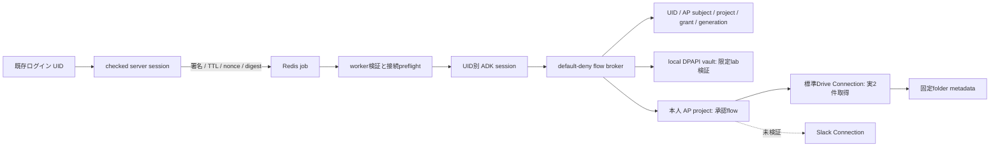

# UID単位の実行設計

static/UID明示schema、fake lifecycle、共有guard、合成履歴移行と選択した標準API認可は[phase1 local/mock](CONTINUATION.md)で確認しました。[phase2](PHASE2-VALIDATION.md)ではpublic-client OAuth、local CurrentUser DPAPI vault、公式MCP SDKを接続し、本人認可A/Bの既存合成flowでnative Web→Redis→worker→実ADK→実APを確認しました。2026-10-12はBの標準Google Connectionで実2件を取得しました。[実結果](GOOGLE-DRIVE-E2E.md)。modelはscriptedで、本番vault・自然言語判断・他providerへの一般化は未完了です。

前提は既存のWebログインと安定したユーザーIDです。clientやLLMにUID/project/tokenを選ばせず、check_signin後のserver sessionからUIDを取り、署名・120秒TTL・payload digest・nonce付きRedis jobでworkerへ伝えます。workerで署名とshared Redis SET NX EXを検証し、ADK session/run/artifactの主体を`cmdbox_uid_<UID>`へ統一します。

tool discoveryとexecutionの両方で実invocationのUID/app/sessionを確認し、cache世代とbindingを照合します。戻り値の直前にもgenerationを再確認します。選んだbrokerに対応するlab_identityまたはlab_drive_search一つ・空引数を通常toolsetへ渡し、今回の実経路は後者です。AP raw management toolsをそのまま公開しません。署名鍵やcredential providerに既定の実secretはなく、bootstrapが依存を注入します。

ADK2.8.0はtoolset取得例外を捕捉してtoolsなしで続行するため、workerでRunner開始前にもbindingを確認します。UIDは表示名変更の影響を受けない識別子として使います。合成ADK履歴移行と選択した標準resource/admin APIの認可はphase1で確認済みですが、実履歴・全管理UI・全動的APIのACLは未完了です。

Google/Slack credentialをAP Connectionへ置いても、APを本人として呼び出す権限の管理は残ります。model/toolへ接続参照だけを渡し、OAuth state/PKCE、本人subject/project/grant照合、AP access/refresh token、refresh/revokeを独立broker/vaultへ置く構成が候補です。共通admin Bearerで全員を呼ぶ方式では本人の委譲・隔離を実現できません。

dummy provider/transportを使う通常mockと、明示承認用のlive moduleを分けています。live moduleはUID/subject/project/client/grantを固定manifestと照合し、AP userinfoで認証されたtokenのclaimを確認します。ローカル独自のHS256署名検証を行ったという意味ではありません。A/B実試験のrefreshは逐次各一回で、実APでの並行refresh競合は未検証です。また、AP flowをMCP toolへ変換する方式と、任意の外部公開MCP serverを透過中継する汎用gatewayは別の機能です。後者は未実装です。

## 固定された上流

| 対象 | 版/commit |
|---|---|
| cmdbox | 0.8.5.4 / `a429260512035aa358d49e7b319c2bfc56532742` |
| AP source | 0.92.2 / `d125d34e59ac57ea4d0df57af4b917344027f06b` |
| ADK / Python MCP | 2.8.0 / 1.26.0 |
| CPython | 3.12.10、hash付きofficial embed |

cmdboxの参照箇所は`cmdbox/app/auth/signin.py`、`features/web/cmdbox_web_do_signin.py`、`features/web/cmdbox_web_agent.py`、`features/cli/cmdbox_agent_chat.py`です。phase1の公開patchは独立copyのWeb agent、AgentChat、SessionList、SessionDelの4ファイルです。phase2 moduleはlab側に置きます。public sourceの元checkoutは変更しません。

## 開発管理と通常実行

CE公式管理MCP42toolsを独立OAuthで実測し、元flowだけを読みap_change_flow_statusで有効化。通常allowlistはlab_drive_searchのまま。scope=mcpとアプリtool権限を同一視しません。

protected bootstrapのflow_budget_private_rootは既存owner-only台帳を参照します。Windowはflowだけを元SQLite app_budgetへ原子的に課金し、code exchangeの新承認1回と混同しません。元countが1でないbootstrapを拒否し、実経路で1→2を確認。3回目の拒否はdummyで確認し、実3回目は実施しません。表示名/model引数から台帳/UIDを選ばず、元台帳2/2を保持しています。
