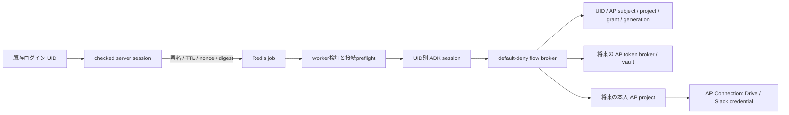

# UID単位の実行設計

前提は既存のWebログインと安定したユーザーIDです。clientやLLMにUID/project/tokenを選ばせず、check_signin後のserver sessionからUIDを取り、署名・120秒TTL・payload digest・nonce付きRedis jobでworkerへ伝えます。workerで署名とshared Redis SET NX EXを検証し、ADK session/run/artifactの主体を`cmdbox_uid_<UID>`へ統一します。

tool discoveryとexecutionの両方で実invocationのUID/app/sessionを確認し、cache世代とbindingを照合します。戻り値の直前にもgenerationを再確認します。LLMへ渡すのは承認済み`lab_identity`、引数は空だけです。AP raw management toolsをそのまま公開しません。署名鍵やcredential providerに既定の実secretはなく、bootstrapが依存を注入します。

ADK2.8.0はtoolset取得例外を捕捉してtoolsなしで続行するため、workerでRunner開始前にもbindingを確認します。UIDは表示名変更の影響を受けない識別子として使います。履歴移行と全標準APIのACL点検は未完了です。

Google/Slack credentialをAP Connectionへ置いても、APを本人として呼び出す権限の管理は残ります。アプリは接続参照のみを保持し、OAuth state/PKCE、本人subject/project/grant照合、AP access/refresh token、refresh/revokeを独立broker/vaultへ置く構成が候補です。共通admin Bearerで全員を呼ぶ方式では本人の委譲・隔離を実現できません。

ここで実装したcredential providerとMCP transportはdummyです。実AP transport/vault/OAuth lifecycleを組み込んだ新adapterは未検証です。また、AP flowをMCP toolへ変換する方式と、任意の外部公開MCP serverを透過中継する汎用gatewayは別の機能です。後者は未実装です。

## 固定された上流

| 対象 | 版/commit |
|---|---|
| cmdbox | 0.8.5.4 / `a429260512035aa358d49e7b319c2bfc56532742` |
| AP source | 0.92.2 / `d125d34e59ac57ea4d0df57af4b917344027f06b` |
| ADK / Python MCP | 2.8.0 / 1.26.0 |
| CPython | 3.12.10、hash付きofficial embed |

cmdboxの参照箇所は`cmdbox/app/auth/signin.py`、`features/web/cmdbox_web_do_signin.py`、`features/web/cmdbox_web_agent.py`、`features/cli/cmdbox_agent_chat.py`です。差分は独立copyの後者2ファイルのみ。public sourceの元checkoutは変更しません。
