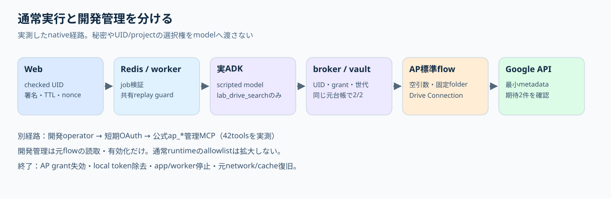

# 何を解決するアイデアか

アプリ利用者が、自分に許可されたGoogle/Slackの操作を使いたいとき、全員で共通の管理者tokenを使うと「誰の権限で動かしたか」が曖昧になる。本案は既存ログインの安定UIDを使い、本人のAP project・Connection・許可flowへ対応づけて実行する。

## 用語を具体的に置き換える

| 用語 | 意味 |
|---|---|
| UID | 表示名が変わっても同じ利用者を示す、アプリの内部番号 |
| Connection | APが本人のGoogle等へ接続するための認証情報と接続先の登録 |
| flow | 「このfolderを検索し、結果metadataを返す」などの作業手順 |
| MCP tool | アプリから呼べる、flowまたは管理操作の受付窓口 |
| broker | 誰の依頼か、使ってよいflowか、認可が有効かを確認して呼ぶ仲介役 |
| grant | 本人がアプリに与えた利用許可。Connectionそのものと別 |

利用者は既存アプリへログインする。アプリは利用者が指定した名前やmodelの推測で主体を選ばず、serverが確定したUIDをworkerまで伝える。APへ進む前に本人のsubject/project/grantを照合し、許可したtoolだけを使う。

## 利用者が行う二つの同意

まずAPの標準Connectで本人Google accountとscopeを確認し、Connectionを登録する。次にアプリの接続画面から本人AP projectをAuthorizeする。前者はGoogleへの接続、後者はアプリによるAP利用であり、片方が済んでももう片方の代わりにならない。

今回成功したAP標準OAuth中継では、顧客/実ユーザーによる独自GCP client登録は不要だった。標準Google appをAP側が用意する経路であり、組織の許可・通信・保管方針の判断は残る。独自OAuth appを使う本番案は別の選択肢。[三者の役割](RESPONSIBILITIES.md)

## 通常利用と開発作業

通常アプリはlab_drive_search一つだけを渡し、固定folder・空引数で呼ぶ。開発担当者は独立した短期OAuthで公式ap_*管理MCPを使い、必要なflowの読取・修正・有効化を行える。管理MCPの42toolsを通常利用者のmodelへ追加する設計ではない。

## 今回できたことと見込み

実測はscripted ADK経由の標準Drive flowによるテスト2件のmetadata取得と終了処理。自然言語から適切なtoolを自律選択するLLM、一般顧客の本番認証、企業policy、複数実Google利用者、Slack、汎用MCP proxyは未検証。利用者の権限で安全に作業手順を提供する土台として使える見込みはあるが、production完成という結論ではない。[実測／見込み／未検証](GOOGLE-DRIVE-E2E.md)
