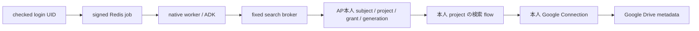

# Google Drive 検索のローカル準備

今回完成したのは、固定版 source の調査、合成 IMPORT_FLOW request、検索結果の契約、native アプリ経路の mock 検証です。実 Google Connection、OAuth client/secret/grant、実ファイル、AP への import/publish、ネットワーク変更は作成・実施していません。既存 phase2 の未公開変更と終了結果を保全し、追加分を別差分としてレビューできます。

対象は AP CE 0.92.2 / `d125d34e59ac57ea4d0df57af4b917344027f06b`。その public source 内の Drive piece は `@activepieces/piece-google-drive` **0.11.0**、MCP piece は **0.0.21**、flow schema は **27** です。現在の running container にある MCP builder、OAuth URL helper、own-client token service は、取得した固定 source と SHA256 が一致しました。Drive source は container の通常 community source ディレクトリにはありません。インストール済み Drive metadata/package の存在・実効版は未確認なので、実行前に別途確認が必要です。source 取得物・詳細 hash・生結果は ignored `local-review/` に置き、vendor していません。

## scope と検索範囲

| 方式 | 権限と今回の扱い |
|---|---|
| `drive.file` | アプリが作成した、または利用者がアプリへ選択・共有したファイルの範囲。既存 Drive 全体や、既存フォルダの子を自動で全件検索できるとは扱わない。Picker 等の選択導線は今回未実装 |
| `drive.metadata.readonly` | アカウントがアクセスできるファイルのメタデータを読み取る restricted scope。既存ファイル名検索に必要な権限候補だが、フォルダ限定の OAuth scope ではない |
| stock piece の `drive` | ファイルの読み書きまで許す restricted scope。検索 action の READ 処理と Connection の広い権限を区別する |

[Google scope 仕様](https://developers.google.com/workspace/drive/api/guides/api-specific-auth) に基づく区別です。`drive.readonly` は内容の読み取り・download まで許すため、メタデータだけの要件より広くなります。production の検証・審査・security assessment の要否は audience、scope、保存/転送形態と公式要件で個別確認し、今回解決済みとはしません。

[固定 auth.ts](https://github.com/activepieces/activepieces/blob/d125d34e59ac57ea4d0df57af4b917344027f06b/packages/pieces/community/google-drive/src/lib/auth.ts) の宣言は `drive` と `email`。固定 UI は宣言 scope の部分集合を選べますが、[server helper](https://github.com/activepieces/activepieces/blob/d125d34e59ac57ea4d0df57af4b917344027f06b/packages/server/api/src/app/app-connection/app-connection-service/oauth2/oauth2-util.ts) は宣言外 scope を拒否します。`drive.file` や `drive.metadata.readonly` を stock Connection の画面へ任意入力して利用できるとの案は採用しません。狭い scope を選ぶ場合は、別途レビューした auth/piece 変更・package identity/version 固定・導入承認・動作確認が必要です。その派生 piece は今回作成・導入していません。`email` を外す選択の実 UI/Google 動作も未検証です。

`'folderId' in parents` は直下の検索条件で、再帰検索や OAuth の認可境界ではありません。scope、Google ACL、アカウント側 policy の範囲内で結果を絞ります。フォルダを指定しても、それ以外のファイルへの credential 権限は消えません。[Drive 検索仕様](https://developers.google.com/workspace/drive/api/guides/search-files)

## 準備した一つの flow

[template](../templates/drive-search-preparation.json) は API の `IMPORT_FLOW` request 形状です。Gallery 配布形式や import 済み flow export ではありません。全 step を `valid:false` とし、Connection、folder、policy、tool name は DUMMY のままです。実行・publish してはいけません。

1. `mcp_tool` / `returnsResponse:true` / `inputSchema:[]`。
2. `drive_search_files`：`name contains CMDBOX_LAB_ONLY`、固定 parent folder、`type:file`、Team Drives 無効。
3. `reply_to_mcp_client`：Advanced mode の明示 wrapper から `contract / policyId / completion / files` を返して stop。

[固定検索 action](https://github.com/activepieces/activepieces/blob/d125d34e59ac57ea4d0df57af4b917344027f06b/packages/pieces/community/google-drive/src/lib/action/drive-search-files.ts) は検索値と folder を q に直接埋め込み、1000 件単位で nextPageToken がなくなるまで巡回します。検索値の quote/backslash escape、`trashed=false`、ページ/総件数上限、`incompleteSearch` の伝達はありません。このため最初の候補は ASCII の固定合成検索語・専用小規模フォルダとします。一般の検索語、fullText、任意 q、再帰、Shared Drives、download、export、書き込みは候補に含めません。stock action の query を UI から一般化する前に、escaping、取得上限、trashed/incompleteSearch を扱う action をレビューする必要があります。

broker は最大20件、許可 metadata field、型、重複 ID、control character、固定 policyId を検査し、LLM には id/name/mimeType のみを返します。大きい結果は失敗させ、切り捨てを完了扱いしません。`completion:unverified-by-stock-piece` を常に返します。この上限は **broker 応答の上限**で、stock piece が Google から取得する件数を制限するものではありません。AP run logs に入る metadata の保管・削除も実運用前の対象です。ファイル名は信頼できないデータであり、指示として実行しません。本番 LLM での prompt injection 耐性は未検証です。

## UID アプリへの接続



Google credential は AP Connection 内に置きます。アプリ側は AP 本人の MCP token と固定 binding を扱い、Google token を chat/tool 引数へ渡しません。ここでの「owner Connection」は、その login UID に対応する本人 project の Connection です。全利用者に共通 owner/admin Bearer を配る設計ではありません。

[検索 broker](../poc/cmdbox_gateway/drive_search.py) は既存の verified invocation と registry を使い、subject/project の固定 policy、UID/session、tool generation、revoke 後の状態、返却直前の generation を照合します。LLM の入力は空 object だけで、UID/project/Connection/query/folder/URL は指定できません。AP raw management tools は公開しません。

新しい [ADK toolset](../poc/cmdbox_gateway/drive_adk.py) の有効化は **mock harness 内の明示 factory 注入のみ**です。既存の `lab_identity` 設定 schema、production bootstrap、phase2 transport/module は変更していません。本番登録と live manifest の確認は残っています。固定 [MCP builder](https://github.com/activepieces/activepieces/blob/d125d34e59ac57ea4d0df57af4b917344027f06b/packages/server/api/src/app/mcp/mcp-server-builder.ts) は trigger 名に flow ID の先頭4文字を加えて normalizer に渡します。実 raw tool name は本人 project で discovery 後に固定し、DUMMY 名を予測して採用しません。現 transport の `_mcp` suffix 制約を満たさない場合は、例外を自動追加せず対応をレビューします。

AP flow-to-tool は Connection/piece/flow を MCP tool にする仕組みです。任意の外部 MCP server の discovery/auth/session を透過中継する汎用 MCP proxy は未実装です。

## 新しい検証結果と再現

新規12契約テストは公式 MCP SDK と httpx.MockTransport を使用しました。native mock は password Web login→WebSocket→共有 Redis→native worker→実 ADK→公式 MCP SDK→fake Drive metadata を通し、4 outcome group を確認しました。

- 同 chat ID の A/B が各自の合成 file のみを返す。B は認可分離 fixture で、実 Google 用に二つ目の flow/account を作る計画ではない。
- dummy refresh 後の新 generation で検索できる。
- dummy revoke 後の A は upstream 前に拒否し、B が継続する。
- 検索 raw call は4回、宣言 alias は検索専用一つ、禁止 socket 試行0、起動した process/worker は停止。

契約テストでは、任意引数・management alias・別 UID・旧 generation・project mismatch・失効 credential・実行中 revoke・別 policy 応答・credential field・不正 metadata・件数上限を拒否しました。最初の mock 応答 prefix の不整合は修正して再検証しました。実 AP A/B の完了試験は再実行していません。

```powershell
.\runtimes\python312\python.exe -B -X utf8 poc\test_drive_search.py
# 既存の専用 mock Redis を利用。18090 が空いている時のみ実行。
.\runtimes\python312\python.exe -B -X utf8 app-lab\test_drive_app.py
```

この成功は stock Drive piece の実行、AP import/validate/publish、Google scope、Google refresh/revoke、実 Connection の owner binding の証明ではありません。次の具体的承認と終了手順は [operator 準備](DRIVE-SEARCH-OPERATOR.md)、集計は [JSON](drive-search-preparation-summary.json) に記載します。
